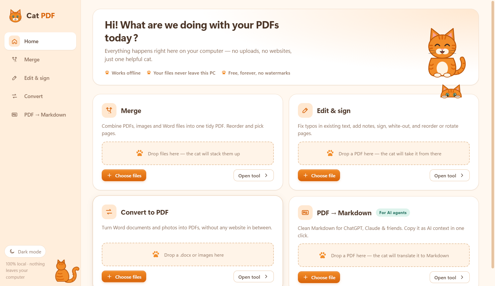
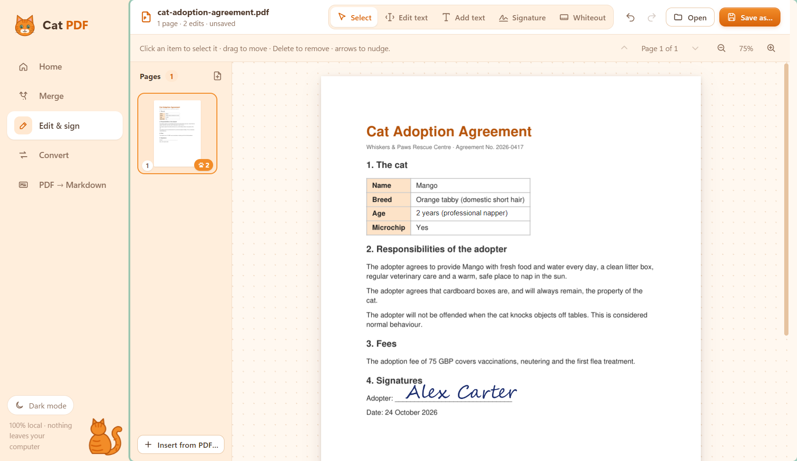
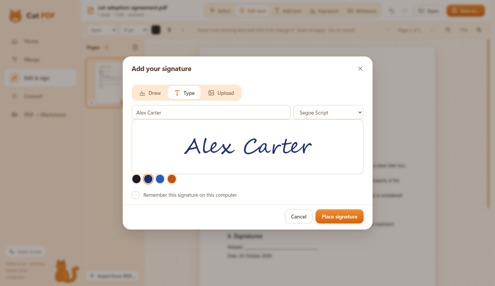
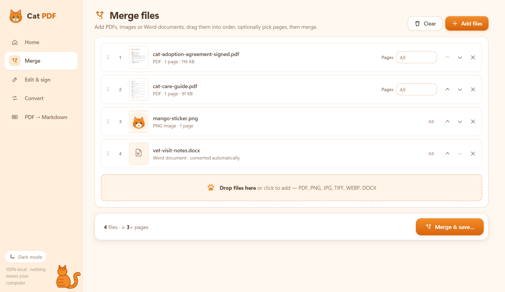
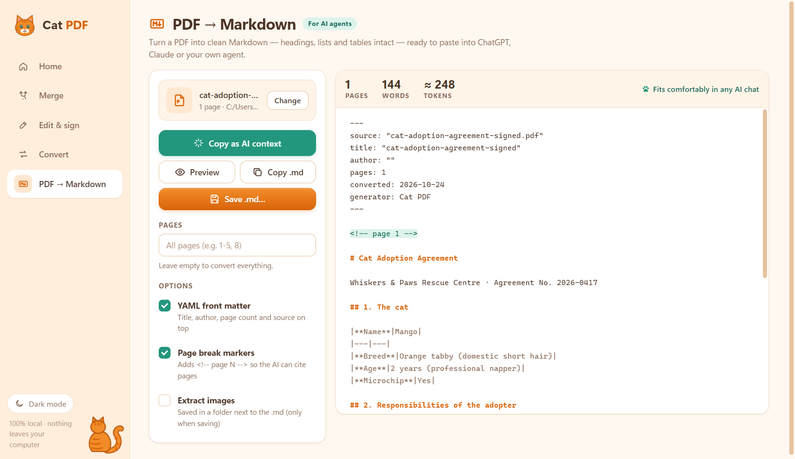
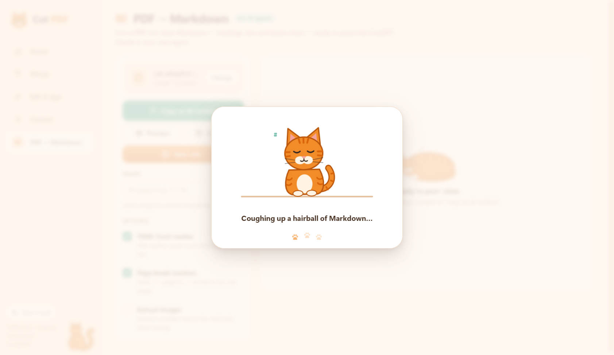
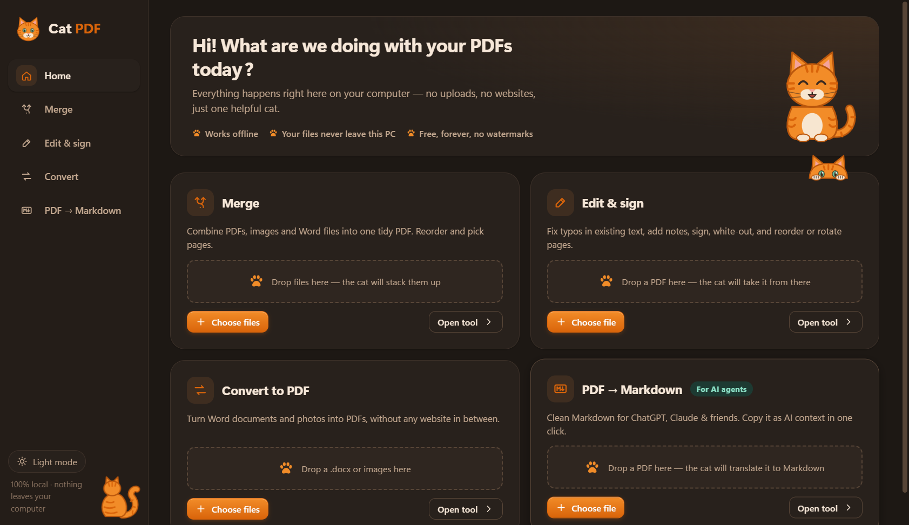
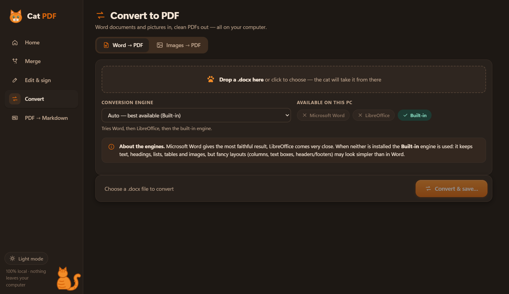

<p align="center">
  
</p>

# Cat PDF 🐈

A local PDF manager. Merge, edit, sign and convert PDFs on your own computer, with no PDF websites and no uploads.
An Electron desktop app talks to a small Python service that only listens on `127.0.0.1`.



## What it does

| Tool | Details |
|---|---|
| **Merge** | PDFs, images (PNG/JPG/TIFF/WEBP…) and Word files into one PDF. Drag to reorder and pick pages per file (`1-3,5`). |
| **Edit & sign** | Click existing text to change it, add new text, add signatures (draw, type or upload, saved for reuse), white-out. Reorder, rotate, duplicate and delete pages, and insert pages from another PDF. Undo/redo. |
| **Convert** | DOCX → PDF and Images → PDF (fit / A4 / Letter, orientation, margins). |
| **PDF → Markdown** | Clean Markdown for AI agents: YAML front matter, `<!-- page N -->` markers, optional image extraction, and word and token counts. **Copy as AI context** puts it on your clipboard in one click. |

Everything shows a "Purr-fect!" card with **Open** and **Show in folder** when it finishes. While it works, a cat chases yarn or kneads your pages.

## A quick tour

### Edit text and sign, right on the page

Click any line to rewrite it, and the new text keeps the original font size and colour. Then drop in a signature and drag it onto the line.



Signatures can be drawn, typed in a handwriting font, or uploaded, in four ink colours. You can save them on your computer to reuse.



### Merge anything into one PDF

Mix PDFs, images and Word documents, put them in order, and pick page ranges per file.



### PDF → Markdown for AI agents

Get clean Markdown with headings, tables and page markers, plus a word and token count so you know it fits your AI chat. **Copy as AI context** puts it on your clipboard in one click.



### A cat keeps you company while you wait

Every operation shows a small cat animation with a rotating message.



### Dark mode

<table>
  <tr>
    <td></td>
    <td></td>
  </tr>
</table>

## Setup (once)

You need **Python 3.10+** and **Node.js 18+** on PATH.

```bash
powershell -ExecutionPolicy Bypass -File scripts/setup.ps1
```

This creates `backend/.venv`, installs the Python packages and installs Electron.

## Run

```bash
npm start
```

Or create **Desktop and Start-menu shortcuts** with the cat icon, so you can launch it like any app:

```bash
powershell -ExecutionPolicy Bypass -File scripts/create-shortcut.ps1
```

Electron starts the Python backend by itself on a random free port, with a random access token, and stops it when you close the window.

## DOCX → PDF engines

| Engine | When it is used | Quality |
|---|---|---|
| Microsoft Word | if Word is installed | best |
| LibreOffice | if `soffice` is installed | very good |
| Built-in | always available | good for normal documents: headings, lists, tables, images. Columns, text boxes, headers and footers come out simpler. |

**Auto** picks the best one available. Neither Word nor LibreOffice is installed on this machine, so **Built-in** is used. Installing LibreOffice (free) gives near-perfect results, and Cat PDF detects it automatically.

## Project layout

```
app/                 Electron
  main.js            window, backend process, dialogs (IPC)
  preload.js         window.catpdf bridge (contextIsolation on)
  renderer/          UI: plain HTML/CSS/ES modules, no build step
    js/views/        home, merge, editor, convert, markdown
    js/cats.js       all the cat SVGs and loader animations
backend/             Python (FastAPI + PyMuPDF)
  catpdf/ops/        merge, edit, convert, markdown, pages: plain functions
  tests/             pytest suite (generates its own fixtures)
docs/API.md          backend API contract
scripts/             setup + shortcut scripts
assets/              app icon (svg/png/ico)
```

## Development

```bash
npm run test:backend
```

To run the backend on its own: `npm run backend` starts it on port 8765 without a token check. API docs are then at http://127.0.0.1:8765/docs. Point the app at it with `CATPDF_BACKEND_URL=http://127.0.0.1:8765`.

## Notes and limits

- **Text editing** swaps the original text for a standard font (Helvetica, Times or Courier, chosen to match the original's style) at the same size and colour. A longer replacement grows to the right (stopping at the next text or a table border) before it shrinks. Text in embedded fonts may look slightly different after editing.
- **Scanned PDFs** (images of text) contain no text to edit or convert to Markdown. There's no OCR yet.
- **Password-protected** PDFs that need a password to open are refused with a clear message.
- **Licence:** PyMuPDF is AGPL-3.0, which is fine for personal use. Keep that in mind if you ever distribute the app.
